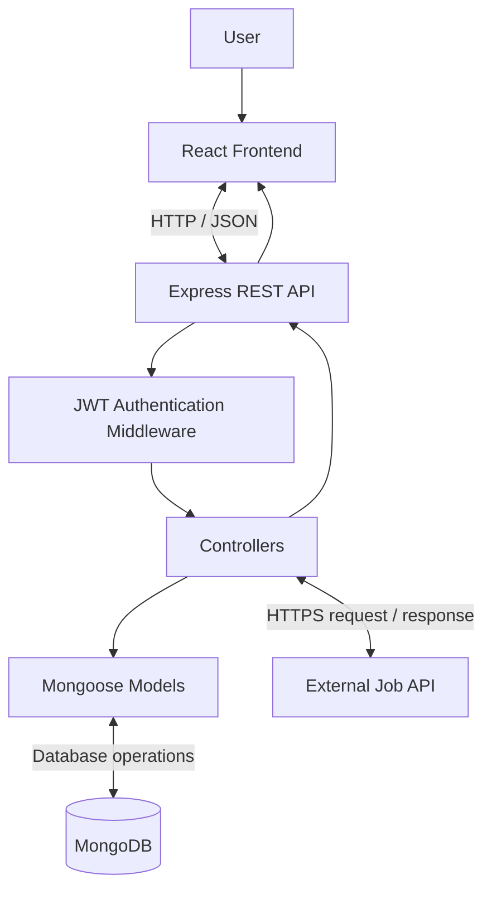
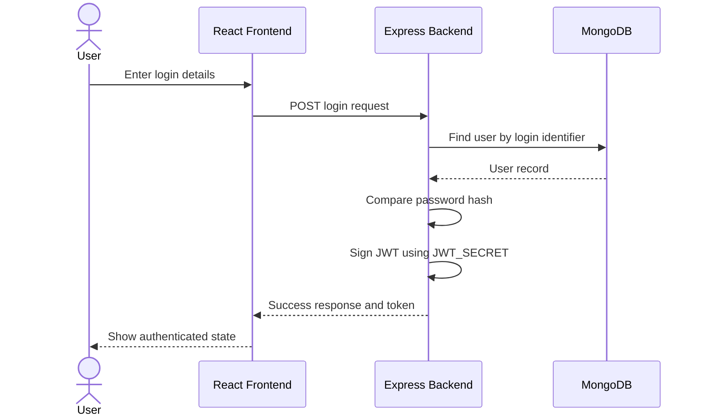
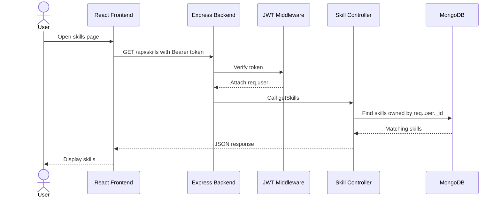
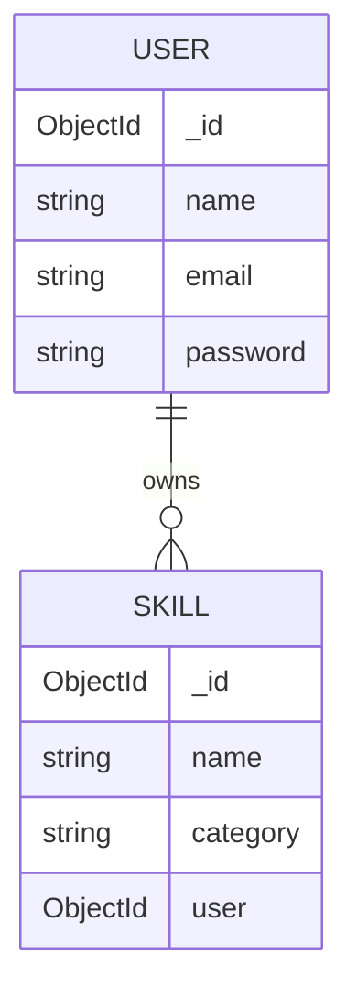

SkillForge AI — High-Level Design (HLD)
Document version: 1.0
Project: SkillForge AI
Document type: High-Level Design
Status: Draft — verify component names and deployed services against the codebase
1. Purpose
This document describes the overall architecture of SkillForge AI. It identifies the major components, their responsibilities, and how information moves between the frontend, backend, database, and external job provider.
2. System overview
SkillForge AI follows a client-server architecture.
- The React frontend displays pages and collects user input.
- The Node.js and Express backend exposes REST API endpoints.
- JWT middleware protects endpoints that require authentication.
- Controllers implement application operations.
- Mongoose models communicate with MongoDB.
- The job-search controller communicates with an external job provider.
3. Architecture diagram

Diagram note: Public authentication routes may not require JWT middleware. Protected skill routes should pass through authentication middleware. The exact middleware placement depends on route configuration.
4. Technology stack
Layer	Technology	Responsibility
Frontend	React.js	User interface and client-side interaction
Backend runtime	Node.js	Runs server-side JavaScript
Backend framework	Express.js	Routing and HTTP request handling
Database	MongoDB	Stores application records
ODM	Mongoose	Defines schemas and performs database operations
Authentication	JSON Web Token (JWT)	Verifies authenticated requests
External data	Job provider API (e.g. Himalayas, if configured)	Supplies job listings
API testing	Postman	Tests endpoints and responses

Only list a provider or tool as part of the actual stack if it is present in the current implementation.
5. Component responsibilities
5.1 React frontend
Responsibilities:
- Display registration and login forms.
- Collect skill information.
- Display the user's saved skills.
- Allow the user to delete a skill.
- Provide job-search input and display returned job listings.
- Display loading, empty, success, and error states.
- Send authentication credentials with protected API requests.
The frontend is not the security boundary. The backend must validate requests and enforce ownership.
5.2 Express application
Responsibilities:
- Create the HTTP server.
- Configure middleware such as JSON parsing and CORS, if used.
- Register API route modules.
- Handle unmatched routes and errors.
- Load configuration from environment variables.
5.3 Routes
Routes map HTTP methods and URL paths to controller functions. They should remain focused on endpoint definitions and middleware attachment rather than containing large business-logic blocks.
5.4 Controllers
Controllers:
- Read route parameters, query parameters, and request body values.
- Use authenticated identity supplied by middleware.
- Call Mongoose models or external services.
- Return suitable HTTP status codes and JSON responses.
Known controller files from the project context:
- server/controllers/skillController.js
- server/controllers/jobController.js
5.5 Authentication middleware
The authentication middleware:
1. Reads the token from the expected request header.
2. Verifies the token using the server-side JWT_SECRET.
3. Identifies the user represented by the token.
4. Attaches authenticated user information to req.user.
5. Calls next() when authentication succeeds.
6. Returns an authentication error when the token is missing, invalid, or expired.
The exact behavior for a missing database user should be verified in the implementation.
5.6 Mongoose models and MongoDB
Mongoose schemas define the shape and validation rules of stored documents. MongoDB stores user and skill records. A skill record is associated with its owner through a user reference, such as an ObjectId.
5.7 External job provider
The backend calls the configured job provider. The frontend should call the backend rather than calling a provider with server secrets directly. The backend normalizes the provider response as required by the UI and handles provider failures.
6. Main data flows
6.1 Login flow

6.2 Protected skill retrieval flow

6.3 Create skill flow
1. User submits a skill form.
2. Frontend sends a POST request to the skill endpoint.
3. Authentication middleware verifies the token.
4. Controller validates the input.
5. Controller creates the skill with the authenticated user's ID.
6. Backend returns the created record and a success status.
6.4 Delete skill flow
1. User requests deletion of a skill.
2. Frontend sends the skill ID in the URL.
3. Authentication middleware verifies the token.
4. Controller searches using both skill ID and authenticated user ID.
5. If a matching owned record exists, it is deleted.
6. If no matching record exists, the backend returns not found.
6.5 Job search flow
1. User enters a job-search term or filters.
2. Frontend sends a request to the backend job endpoint.
3. Job controller validates the parameters.
4. Backend calls the external job API.
5. Backend processes the provider response.
6. Backend returns job results or a controlled error response.
7. Logical data model
The following is a conceptual model. Confirm exact fields and collection names against the Mongoose schemas.

- One user can own multiple skill documents.
- Each skill document belongs to one user.
- The user reference is used to enforce data ownership in queries.
- Password values shown in the diagram represent stored password hashes, not plain-text passwords.
8. API overview
The following paths reflect the project context and should be checked against the actual route files before submission.
Method	Endpoint	Access	Purpose
POST	/api/auth/register	Public	Register a user
POST	/api/auth/login	Public	Authenticate a user
GET	/api/skills	Protected	Get the authenticated user's skills
POST	/api/skills	Protected	Create a skill for the authenticated user
DELETE	/api/skills/:id	Protected	Delete an owned skill
GET	/api/jobs	Depends on implementation	Search external job listings

9. Security design
- JWT signing and verification use the same server-side secret.
- JWT_SECRET is stored in the backend environment, not in frontend code.
- Passwords should be hashed before storage.
- Protected routes use authentication middleware.
- Controllers use req.user._id for user-specific database operations.
- Delete operations match both the record ID and owner ID.
- Input validation is performed on the backend.
- Secrets and password hashes are excluded from API responses and logs.
10. Error handling approach
Situation	Typical status
Successful resource creation	201
Successful read or delete	200
Invalid request data	400
Missing or invalid authentication	401
Authenticated user lacks permission	403
Resource not found / not owned	404
Invalid response from upstream job service	502
Unexpected backend failure	500

Use the status that matches the actual failure. Do not return 401 for every kind of error.
11. Deployment view
A typical deployment can contain:
- React frontend hosted on a static frontend hosting platform.
- Node/Express backend hosted on a Node-compatible service.
- MongoDB hosted on MongoDB Atlas or another MongoDB server.
- Environment variables configured separately for frontend and backend.
- HTTPS enabled for production traffic.
Fill in the actual hosting provider, URLs, and deployment configuration before submission. Do not claim deployment if the project is only running locally.
12. Scalability and future considerations
Possible improvements when needed:
- Pagination for large skill or job result sets.
- Indexes for frequently queried fields.
- Caching for repeated external job searches.
- Rate limiting for public endpoints.
- Request timeouts and retry policies for external services.
- Centralized structured logging and monitoring.
- Background processing for large skill-analysis jobs.
These are design options, not claims that they are already implemented.
13. HLD decisions to confirm
- Actual frontend hosting provider: Not hosted
- Actual backend hosting provider: Not hosted
- Actual MongoDB environment: MongoDB Atlas
- Actual job provider: public api key
- Actual authentication token storage method on frontend: 
- Whether the job endpoint is protected: 